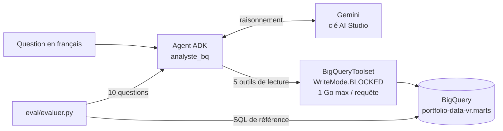

# Agent IA sur BigQuery : un analyste qui écrit son SQL, et sa note

   

Un agent conversationnel qui répond en français aux questions sur un entrepôt de ventes BigQuery : il lit le
schéma, écrit le SQL, l'exécute et répond avec le chiffre, la requête et une interprétation. Il est construit avec
**Google ADK** (Agent Development Kit) et le modèle **Gemini**, et **évalué sur 10 questions dont la bonne
réponse est connue**.

**Résultat : 9 réponses justes sur 10.** L'erreur restante est documentée plus bas : c'est la plus instructive.

**Démo en ligne : [agent-ia.76.13.43.130.sslip.io](https://agent-ia.76.13.43.130.sslip.io)** (identifiants sur
demande). Elle tourne dans un conteneur sur un VPS, derrière un mot de passe, avec un compte de service qui n'a
que deux droits : lancer des requêtes et lire le dataset `marts`. Les requêtes du projet sont plafonnées à 16 Go
par jour, ce qui reste sous l'offre gratuite de BigQuery.

## Contexte

Un agent qui « parle à la base » est facile à montrer et difficile à croire : un SQL qui s'exécute n'est pas un
chiffre juste. Ce projet branche un agent sur l'entrepôt du [projet 13](https://github.com/valentinratigniet-byte/projet-13-entrepot-central-bigquery)
(schéma en étoile : `fct_sales`, 121 331 lignes de ventes, et les dimensions client, produit et date), puis le
note comme on recette un indicateur : chaque réponse est comparée à une valeur de référence calculée en SQL.

## Garde-fous

| Risque | Parade | Où |
|---|---|---|
| L'agent modifie ou supprime des données | `WriteMode.BLOCKED` : seules les requêtes `SELECT` passent, bloquées côté outil | `analyste_bq/agent.py` |
| Une requête coûte cher | `maximum_bytes_billed` = 1 Go par requête, et BigQuery refuse au-delà | `analyste_bq/agent.py` |
| Des outils facturés sont appelés sans qu'on le voie | prévision ML et « data insights » retirés de la boîte à outils, il reste 5 outils de lecture | `tool_filter` |
| Une clé API publiée | `.env` ignoré par git ; BigQuery passe par les identifiants `gcloud` de l'utilisateur | `.gitignore` |
| Un chiffre faux présenté comme juste | jeu d'évaluation avec réponses de référence | `eval/` |

## Ce que l'évaluation a appris

**1. Le SQL était juste, la règle métier manquait.** À la première question (« les 5 produits qui rapportent le
plus en 2025 »), l'agent a produit une jointure correcte, mais il comptait les commandes annulées dans le chiffre
d'affaires (4 231 lignes en 2025). Le SQL n'avait rien de faux, c'est la définition qui l'était. La règle
« le chiffre d'affaires exclut `status = 'cancelled'` » a été ajoutée aux instructions de l'agent.

**2. Une règle mal bornée déborde.** Une fois la règle ajoutée, l'agent l'applique aussi là où elle n'a rien à
faire. À la question Q3 (« combien de clients ont passé au moins une commande en 2025 ? »), il exclut les clients
dont les commandes sont toutes annulées : 4 854 au lieu de 4 889. Une règle métier donnée à un agent doit dire à
quoi elle s'applique, et aussi à quoi elle ne s'applique pas. Ce n'est pas corrigé, pour garder la mesure honnête.

**3. Le gratuit a ses contraintes.** Sur l'offre gratuite de Gemini, les modèles les plus demandés renvoient
souvent « saturé » (503) ou « quota dépassé » (429). L'agent tourne sur `gemini-flash-lite-latest`, et
l'évaluation attend puis réessaie au lieu de compter une panne comme une mauvaise réponse.

| # | Question | Référence | Agent |
|---|---|---:|:---:|
| Q1 | Chiffre d'affaires total 2025 | 33 783 042,84 | ✅ |
| Q2 | Commandes 2025, tous statuts | 19 845 | ✅ |
| Q3 | Clients ayant commandé en 2025 | 4 889 | ❌ 4 854 |
| Q4 | Panier moyen 2025 | 1 834,14 | ✅ |
| Q5 | Chiffre d'affaires de décembre 2025 | 2 962 774,32 | ✅ |
| Q6 | Part des commandes annulées en 2025 | 7,19 % | ✅ |
| Q7 | CA 2025 du produit n° 1 | 51 814,35 | ✅ |
| Q8 | CA 2025 du premier pays | 270 698,64 | ✅ |
| Q9 | CA 2025 de la première catégorie | 4 007 567,54 | ✅ |
| Q10 | Articles vendus le week-end en 2025 | 39 537 | ✅ |

Le détail (SQL de référence, SQL écrit par l'agent, réponse complète) est dans
[`eval/resultats.md`](eval/resultats.md).

## Architecture



L'évaluation compte une réponse comme juste si la valeur de référence apparaît dans le texte de l'agent, à 0,5 %
près (arrondis compris). Le parseur lit le format français (`52 207,10 €`) et se vérifie lui-même au lancement.

## Structure

```
analyste_bq/
  agent.py          l'agent : instructions, outils BigQuery, garde-fous
  .env.example      modèle du fichier de clé (le vrai .env n'est jamais commité)
eval/
  questions.json    10 questions + SQL de référence
  evaluer.py        lance l'agent sur chaque question et compare
  resultats.md      dernière exécution
```

## Lancer le projet

Prérequis : Python 3.12, le Google Cloud CLI connecté (`gcloud auth application-default login`) avec un accès en
lecture au dataset, et une clé Gemini gratuite ([aistudio.google.com/apikey](https://aistudio.google.com/apikey)).

```bash
python -m venv .venv && .venv/Scripts/activate      # Windows ; source .venv/bin/activate ailleurs
pip install -r requirements.txt
cp analyste_bq/.env.example analyste_bq/.env        # puis y coller la clé
adk web --port 8000 .                               # interface de discussion sur http://127.0.0.1:8000
python eval/evaluer.py                              # réécrit eval/resultats.md
```

Pour l'appliquer à un autre dataset, il suffit de changer le projet et le dataset dans `agent.py` et dans
`questions.json`.

## Limites

- **Taille de l'évaluation** : 10 questions, c'est une recette, pas un benchmark. Les questions ouvertes
  (« pourquoi les ventes baissent-elles ? ») ne sont pas notées automatiquement.
- **Dépendance au modèle** : un autre modèle Gemini peut donner un autre score. Le modèle utilisé est inscrit
  dans `resultats.md` à chaque exécution.
- **Pas de déploiement** : l'agent tourne en local. Le déployer sur Agent Runtime (Vertex AI) est possible mais
  facturé à l'usage, ce que ce projet évite volontairement.
- **Données fictives** : l'entrepôt du projet 13 est alimenté par des données générées avec Faker (projet 07).
